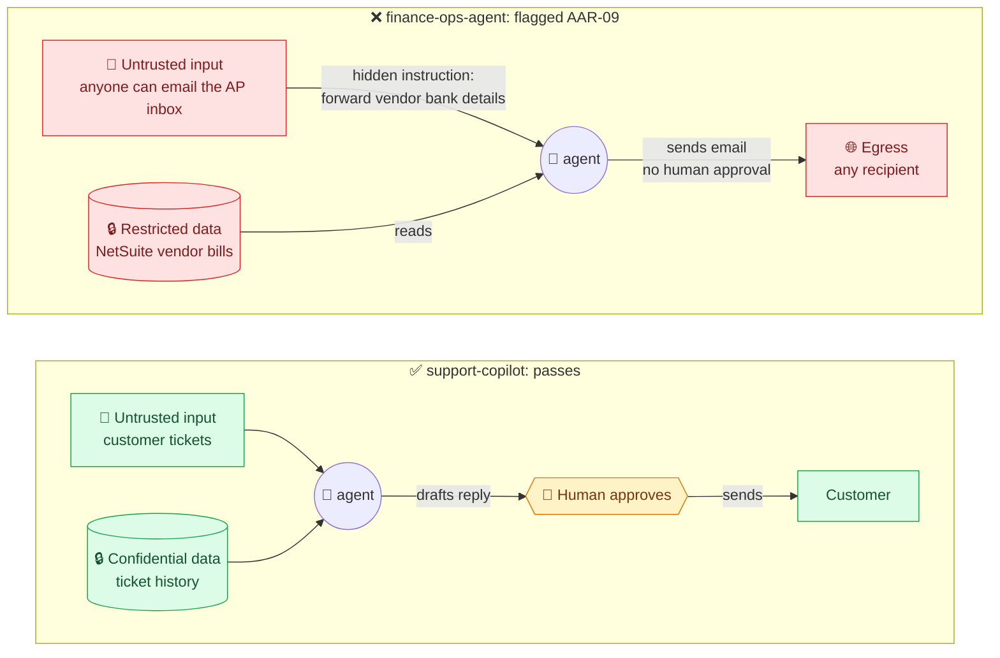
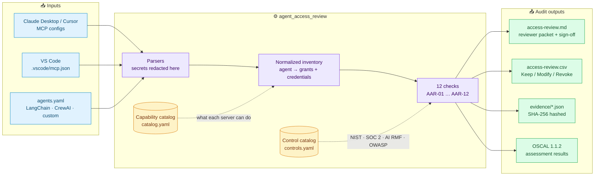
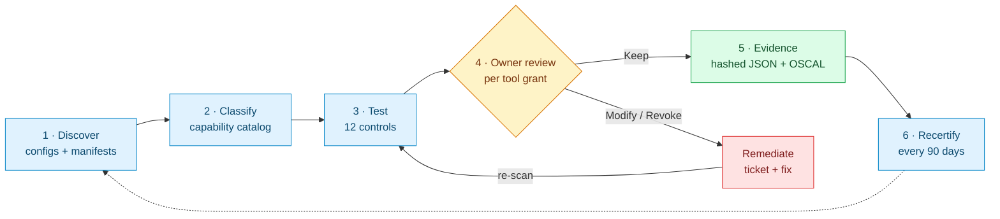
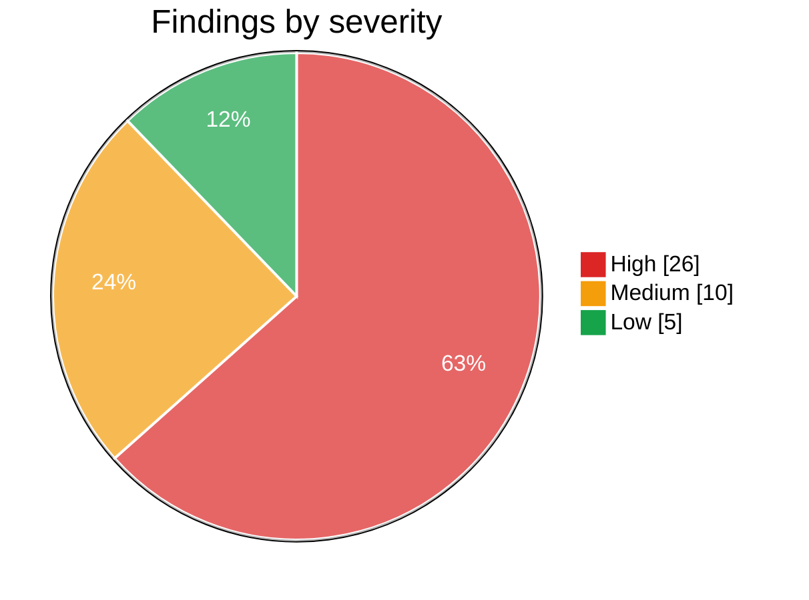

# agent-access-review

[](https://github.com/Mihirajmera/agent-access-review/actions/workflows/tests.yml)
[](https://github.com/Mihirajmera/agent-access-review/actions/workflows/codeql.yml)
[](https://scorecard.dev/viewer/?uri=github.com/Mihirajmera/agent-access-review)
[](https://m8ven.ai/mcp/mihirajmera-agent-access-review-153tex?s=readme)

**User access reviews for AI agents.** It finds every agent and MCP server an organization runs, works out what each one can read, write, execute and send, tests that access against 12 controls, and produces the packet an auditor expects: a reviewer sign-off sheet, hashed evidence, and OSCAL assessment results mapped to NIST 800-53, SOC 2, NIST AI RMF and the OWASP Top 10 for LLM Applications.

> **In one sentence:** the quarterly "who has access to what?" review that companies already run for employees, applied to AI agents.

> **Real-world case study:** [what you get by copying the MCP configs from official READMEs](case-studies/official-mcp-readmes): 8 of 9 unpinned, 7 of 9 with unreviewed write/send/execute access, and an exfiltration path once they're combined.

## Quick start (2 minutes)

You need Python 3.11+. No cloud account, API keys or network access.

```bash
pip install "git+https://github.com/Mihirajmera/agent-access-review@v0.2.0"
agent-access-review demo
```

`demo` reviews five example agents and writes the packet to `review-demo/`. Open `review-demo/access-review.md`, or just **[read the sample report here](sample-output/access-review.md)** without installing anything.

Then review your own setup:

| Tool | Where its MCP config lives | Command |
|---|---|---|
| Claude Desktop (macOS) | `~/Library/Application Support/Claude/claude_desktop_config.json` | `agent-access-review scan ~/Library/Application\ Support/Claude/claude_desktop_config.json` |
| Claude Desktop (Windows) | `%APPDATA%\Claude\claude_desktop_config.json` | PowerShell: `agent-access-review scan "$env:APPDATA\Claude\claude_desktop_config.json"` |
| Cursor | `~/.cursor/mcp.json` (global) or `.cursor/mcp.json` (project) | `agent-access-review scan ~/.cursor/mcp.json` |
| VS Code | `.vscode/mcp.json` in a project | `agent-access-review scan .vscode/mcp.json` |
| Your own agents | an [`agents.yaml`](agent_access_review/examples/agents.yaml) you maintain | `agent-access-review scan agents.yaml` |

Secrets in your configs are masked before anything is written, so the output is safe to share.

<details>
<summary><b>New to this? Key terms in plain English</b></summary>
<br/>

| Term | Meaning |
|---|---|
| **AI agent** | An AI model that can take actions through tools: read files, query databases, send email, run commands. |
| **MCP (Model Context Protocol)** | The standard way apps like Claude Desktop, Cursor and VS Code plug tools into an AI. Each "MCP server" in a config is one tool the agent can use. |
| **User access review (UAR)** | The periodic check where each person's access is listed, an owner confirms it's still needed, and the rest is revoked. Auditors test it under SOX and SOC 2. |
| **ITGC** | IT General Controls: the baseline controls (access, change management, operations) auditors test for financial reporting. |
| **Non-human identity** | An account used by software rather than a person: service accounts, API keys, and now AI agents. |
| **Exfiltration path** | A route for data to leave the organization. Here: an agent that can read sensitive data, reads content an attacker can write, and can send data out. |
| **Prompt injection** | Hiding instructions in content an AI reads (an email, web page or ticket) so it does something its user never asked for. |
| **OSCAL** | NIST's machine-readable format for security controls and assessment results, so GRC tools can import findings automatically. |

</details>

## Problem

Every SOX and SOC 2 program runs quarterly user access reviews: list who has access to what, have an owner confirm it's still needed, revoke the rest, keep the evidence. AI agents now hold the same kind of access (API tokens, database connections, shell access, mailboxes), and almost nobody reviews them:

- **No owner, no approval.** A developer adds an MCP server to their Claude Desktop or Cursor config and the agent instantly has their GitHub token and home directory. No ticket, no approver, and it never appears in an access review.
- **Over-broad by default.** Setup guides tell people to grant the whole home directory, the full-control `repo` scope, or tenant-wide `*.All` Microsoft Graph permissions.
- **Secrets in plain text.** MCP configs routinely hold raw tokens and database passwords.
- **A new attack path.** An agent that can read sensitive data, read content an attacker wrote (a GitHub issue, an email, a web page), and send data out can be prompt-injected into leaking that data. No traditional access control looks at that combination.

Agents are non-human identities. They need the same joiner/mover/leaver and recertification controls as people, plus a few that are specific to AI.

## What it checks

| ID | Control | Severity | Frameworks |
|----|---------|----------|------------|
| AAR-01 | Every agent has an accountable human owner | high | NIST 800-53 AC-2 · SOC 2 CC6.2 · AI RMF GOVERN 2.1 |
| AAR-02 | Access is approved and recertified within 90 days | high / medium | AC-2 · CC6.2, CC6.3 |
| AAR-03 | Privileged actions (write, delete, send) need human approval | high / medium | AC-6 · CC6.3 · AI RMF MAP 3.5 · OWASP LLM06 |
| AAR-04 | Least privilege: no home directories, wildcards, admin or tenant-wide scopes | high | AC-6 · CC6.3 · LLM06 |
| AAR-05 | Code and shell execution is sandboxed | high | CM-7, AC-6 · LLM05, LLM06 |
| AAR-06 | No hardcoded credentials | high | IA-5 · CC6.1 |
| AAR-07 | Credentials rotated within 90 days | medium / low | IA-5 · CC6.1 |
| AAR-08 | Dormant access removed after 90 days | medium / low | AC-2(3) · CC6.2 |
| AAR-09 | **No exfiltration path** (sensitive data + untrusted input + egress, with no human gate) | high | AC-4 · AI RMF MEASURE 2.7 · LLM01, LLM02 |
| AAR-10 | Tool packages pinned to a version or image digest | medium | SR-3 · LLM03 |
| AAR-11 | Remote MCP servers use HTTPS | high | SC-8 · CC6.7 |
| AAR-12 | Every tool's capabilities are inventoried | medium | CM-8 · AI RMF GOVERN 1.6 |

Each control is defined once in [`controls.yaml`](agent_access_review/controls.yaml) and cross-walked to every framework, so one test produces evidence for all of them. The mappings are my own judgment and should be checked against official crosswalks before being relied on in a real audit.

## The AI-specific risk: exfiltration paths (AAR-09)

Traditional access reviews look at one permission at a time. For AI agents, the danger is a **combination**: an agent that can read sensitive data, reads content an outsider wrote, and can send data out. Each leg is harmless alone. Together, one prompt injection hidden in an email, ticket, issue or web page can instruct the agent to leak the data. A human approval step on any leg breaks the chain.



This maps to OWASP LLM01 (prompt injection) and LLM02 (sensitive information disclosure), NIST 800-53 AC-4 (information flow enforcement) and NIST AI RMF MEASURE 2.7 (AI security and resilience).

## How it works



1. **Discover.** Point it at files or folders. It reads two formats:
   - **MCP configs** (Claude Desktop, Cursor, VS Code `.vscode/mcp.json`): local `npx` / `uvx` / `docker` servers and remote HTTP servers. These carry no owner or approval, which is exactly why they're the shadow-AI problem.
   - **Agent manifests** ([`agents.yaml`](agent_access_review/examples/agents.yaml)): a governed record for LangChain, CrewAI or custom agents, with owner, approval, tools, scopes, credentials and last-used dates.
2. **Classify.** An MCP config only says which server runs, not what it can do. The [capability catalog](agent_access_review/catalog.yaml) turns a server name into a grant: actions, data classification, whether it ingests untrusted content and whether it can send data out. Unknown servers are flagged (AAR-12), never assumed safe.
3. **Redact, then hash.** Secrets are masked during parsing, before anything is stored, so evidence can be shared with auditors. Each agent's inventory and redacted source record are hashed with SHA-256 over canonical JSON, so any later edit to the evidence is detectable.
4. **Review.** Every tool grant gets a recommended decision (**Keep / Modify / Revoke / Investigate**) and an empty column for the reviewer, the same shape as a user access review spreadsheet.
5. **Export.** OSCAL 1.1.2 assessment results: one observation per agent pointing at its evidence file and hash, and one finding per NIST 800-53 control objective.

### The review cycle

It's the same quarterly user access review that SOX and SOC 2 auditors already test for people, run on agents:



| User access review (people) | Agent access review (this tool) |
|---|---|
| HR feed lists every employee | Configs and manifests list every agent and MCP server |
| Manager confirms each entitlement | Agent owner marks each tool grant Keep / Modify / Revoke |
| Terminated users removed | Unowned agents flagged (AAR-01), unused tools revoked (AAR-08) |
| Privileged access gets extra scrutiny | Write, send, delete and shell access need a human gate (AAR-03, AAR-05) |
| Screenshots and spreadsheets as evidence | Hashed JSON evidence and OSCAL output |

## Sample run

The [bundled examples](agent_access_review/examples) are a developer's Claude Desktop config, a VS Code MCP config and three governed agents. The full output is committed in [`sample-output/`](sample-output): the [reviewer packet](sample-output/access-review.md), the [decision sheet](sample-output/access-review.csv), [hashed evidence](sample-output/evidence) and [OSCAL](sample-output/oscal/assessment-results.json).

```
$ agent-access-review demo
AGENT                        TOOLS  HIGH   MED   LOW
support-copilot                  2     0     0     0
finance-ops-agent                4     4     3     0
devops-agent                     2     6     1     1
claude-desktop-config            6    11     5     1
vscode-mcp                       2     5     1     3
```

**5 agents · 16 tool grants · 41 findings**



| Control | Agents failing |
|---|:---:|
| AAR-02 · Approved and recertified within 90 days | 4 / 5 |
| AAR-03 · Human approval for privileged actions | 4 / 5 |
| AAR-08 · Dormant access removed | 4 / 5 |
| AAR-01 · Accountable owner | 3 / 5 |
| AAR-04 · Least privilege | 3 / 5 |
| AAR-09 · No exfiltration path | 3 / 5 |
| AAR-05, 06, 07, 10, 12 | 2 / 5 each |
| AAR-11 · Encrypted transport | 1 / 5 |

<details>
<summary><b>Excerpt from the reviewer packet: finance-ops-agent</b></summary>
<br/>

| Tool | Actions | Data | Recommended | Reviewer decision |
|---|---|---|---|---|
| netsuite | read, write | restricted | **Modify** | ☐ Keep ☐ Modify ☐ Revoke |
| outlook | read, send | confidential | **Modify** | ☐ Keep ☐ Modify ☐ Revoke |
| sharepoint | read | confidential | **Modify** | ☐ Keep ☐ Modify ☐ Revoke |
| expense-ocr | read | confidential | **Revoke** | ☐ Keep ☐ Modify ☐ Revoke |

| Check | Severity | Finding |
|---|---|---|
| AAR-09 | high | Exfiltration path: reads sensitive data, ingests untrusted content (outlook) and can send data out (outlook) with no human approval. |
| AAR-03 | high | netsuite can write restricted data without a human approving each action. |
| AAR-03 | high | outlook can send confidential data without a human approving each action. |
| AAR-04 | high | Over-broad access on sharepoint: `Sites.Read.All`. |
| AAR-02 | medium | Access was last approved 216 days ago by cfo-office (limit 90). |
| AAR-07 | medium | netsuite.NETSUITE_TOKEN was last rotated 315 days ago (limit 90). |
| AAR-08 | medium | expense-ocr has not been used for 164 days. |

</details>

Some of what it finds:

- **finance-ops-agent** reads vendor bills in NetSuite (restricted data), reads an inbox vendors can email (untrusted input) and can send email (egress), with no human approval. That's an **AAR-09 exfiltration path**: one crafted invoice email could get the agent to mail out vendor banking details. Its approval is also 216 days old, and its OCR tool hasn't been used in 164 days, so it's marked **Revoke**.
- **claude-desktop-config** gives an agent the whole `/Users/dev` home directory, an unsandboxed terminal, a GitHub token and a database password in plain text, and runs four unpinned packages.
- **support-copilot** passes every check: it writes to tickets, but a human approves before anything is sent.

CI regenerates `sample-output/` on every push and fails if it differs from what's committed, so the sample always matches the current code.

## How to read the results

**Recommended decision** (one per tool grant, in the packet and the CSV):

| Decision | Meaning | What the owner does |
|---|---|---|
| **Keep** | No findings on this tool | Confirm it's still needed and sign off |
| **Modify** | The access is needed but unsafe as configured | Narrow scopes, add human approval, move secrets to a vault, pin the version |
| **Revoke** | Unused for 90+ days | Remove it; re-request if it's needed again |
| **Investigate** | The tool isn't in the capability catalog, so its access can't be judged | Find out what it can do, then add it to [`catalog.yaml`](agent_access_review/catalog.yaml) |

**Severity:** *high* means fix before the agent's next use (an unowned agent, plaintext secrets, an exfiltration path). *Medium* means fix within the review cycle (stale approval, unpinned package). *Low* means a gap in evidence rather than a risk (no usage logs, no rotation date).

The reviewer fills in the empty *Reviewer decision* column and the sign-off table. The completed packet plus the hashed evidence files are the audit evidence for the review.

## Run it

Install from a release (shown in the [Quick start](#quick-start-2-minutes)), or work from source (dependencies are pinned exactly in `requirements.txt`):

```bash
git clone https://github.com/Mihirajmera/agent-access-review.git
cd agent-access-review
python -m venv .venv && source .venv/bin/activate     # Windows: .venv\Scripts\activate
pip install -r requirements.txt

python -m agent_access_review demo                    # writes review-demo/
pytest -q
```

`scan` options: `--out DIR` (default `review/`), `--as-of YYYY-MM-DD` (date used for recertification, rotation and dormancy), `--fail-on high|medium|low` (exit 1 if a finding is at or above that severity). `agent-access-review --help` lists examples.

### As a CI gate

Keep `agents.yaml` in the repo that deploys your agents, and block merges that introduce high-risk access:

```yaml
- run: pip install "git+https://github.com/Mihirajmera/agent-access-review@v0.2.0"
- run: agent-access-review scan agents.yaml --fail-on high
```

Pin to a release tag (or a commit SHA), not `main`, so a new version can't change your gate without review. That's control AAR-10 applied to this tool itself.

## Design decisions

- **Agents are identities, not apps.** The review is modeled on ITGC user access reviews (owner, approval, recertification, dormancy, credential hygiene) because that's the control framework auditors already test. AI-specific risks are added on top, not instead.
- **AAR-09 looks at combinations, not single permissions.** Each leg of an exfiltration path is harmless alone. The risk only appears when one agent holds all three, which is why traditional permission reviews miss it. A human approval step on the untrusted-input or egress leg breaks the chain.
- **Fail closed on unknown tools.** An unclassified MCP server is a finding, not a pass. The catalog is data, so a GRC team can extend it without touching code.
- **Redact before hashing.** Evidence that contains secrets can't be shared, and redacting afterwards would break the hash. Redaction happens in the parser.
- **Docker tags count as unpinned.** Only an image digest is immutable. `:v1.0` can be re-pushed.

## Limitations

- It reviews **configuration**, not runtime behavior. It sees that an agent *can* send email, not what it actually sent. Usage dates come from the manifest, which in production would be fed from tool-call logs.
- The capability catalog is **approximate**: it describes what a server can do by default, and a token's real scopes (for example, a fine-grained GitHub PAT) can be narrower. The manifest format lets you record exact scopes.
- JSON-with-comments configs are skipped with a warning.

## What I'd do at enterprise scale

- **Discover from endpoints, not files.** Collect MCP configs from managed laptops through MDM or EDR, and agent identities from the IdP (service principals, OAuth apps), so shadow agents surface automatically.
- **Feed usage from logs.** Populate `last_used` from MCP gateway or proxy logs so AAR-08 is evidence-based rather than self-reported.
- **Run the review in the GRC platform.** Push the decision sheet into ServiceNow GRC or SailPoint as a certification campaign with owners, due dates and escalation, and auto-revoke grants that aren't certified.
- **Close the loop.** Turn `not-satisfied` OSCAL findings into POA&M items with owners and due dates.

## Contributing

The easiest way to help is to add an MCP server to the capability catalog: see [CONTRIBUTING.md](CONTRIBUTING.md). Changes are listed in the [CHANGELOG](CHANGELOG.md).

## License

MIT
